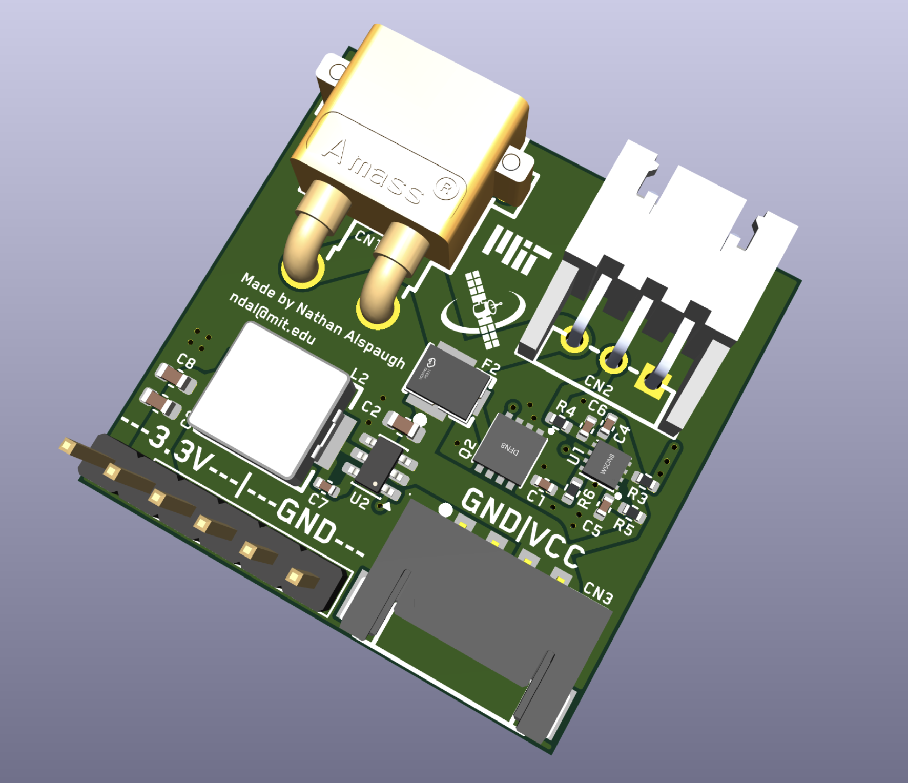

# HAB-battery-board

Battery board for the MIT Satellite team. Takes in a 2S LiPo and outputs 3.3V + BAT after protecting from overvoltage and undervoltage.

> Made by Nathan Alspaugh
(ndal@mit.edu)

